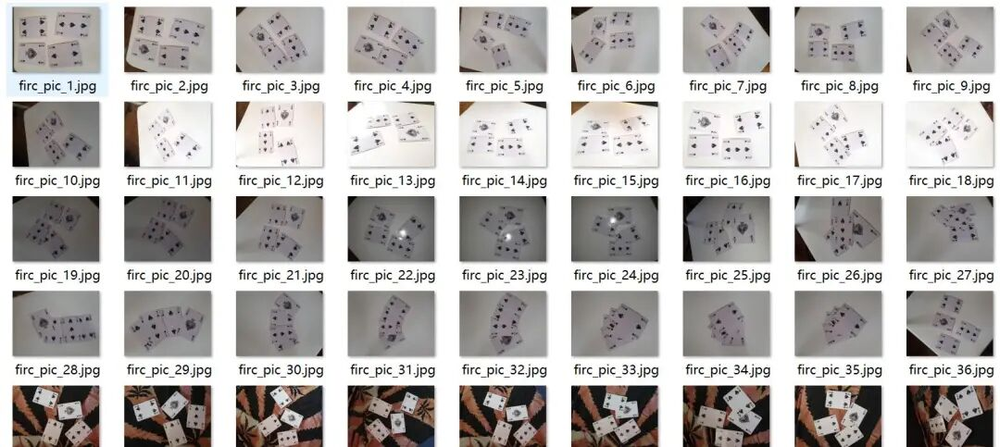
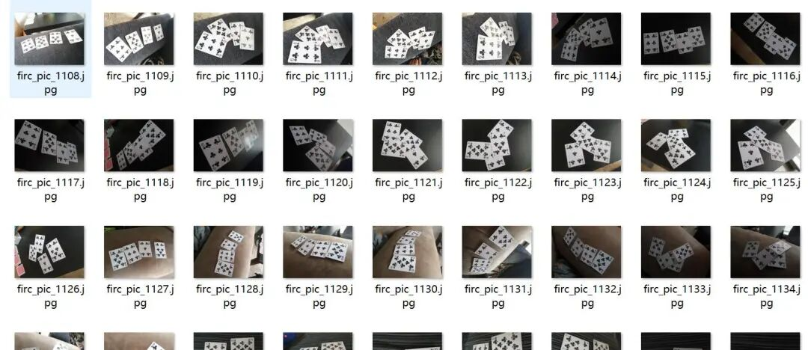
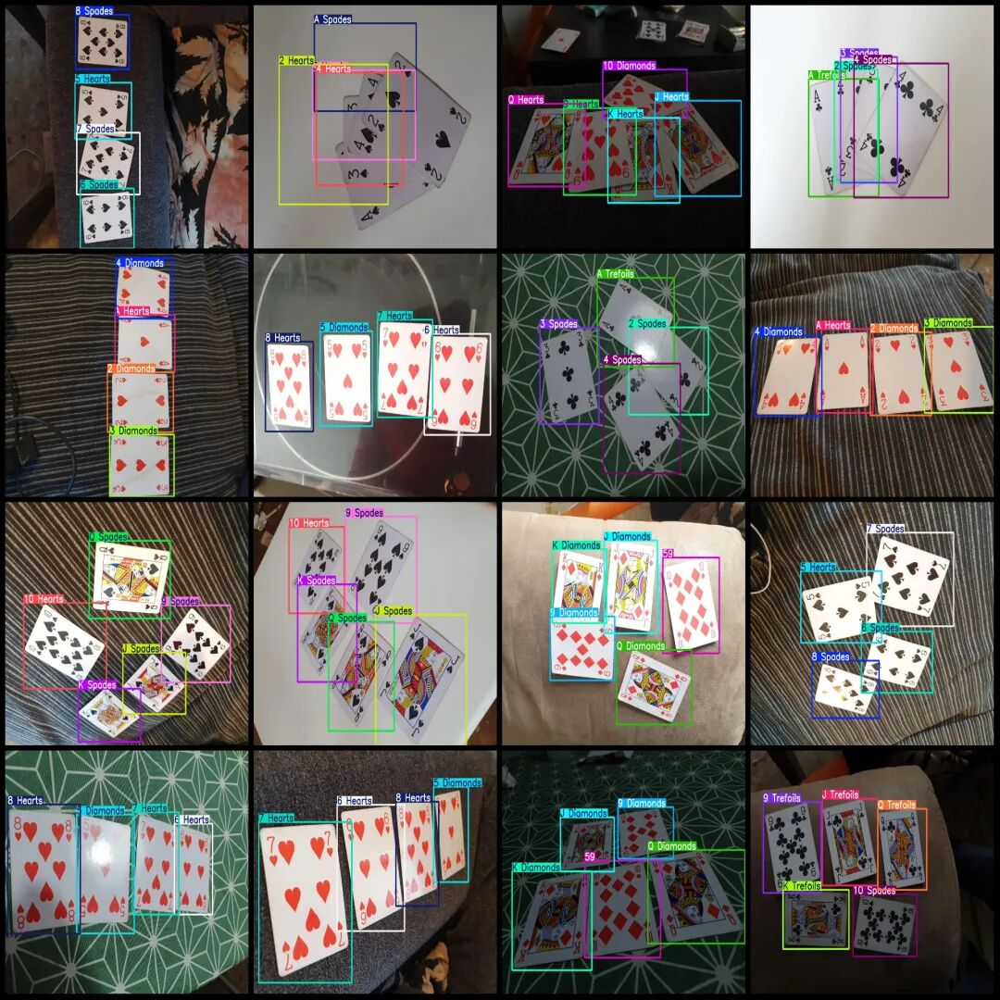
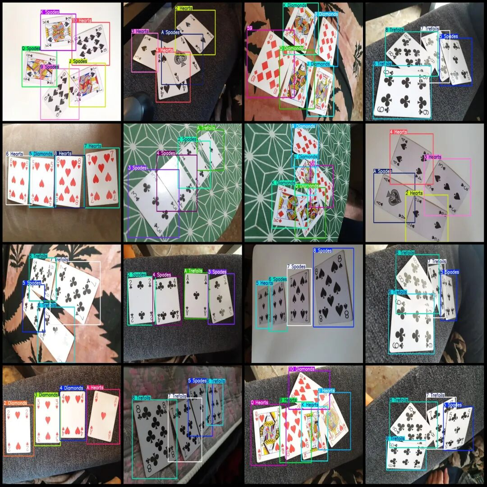

# Dataset for Poker Cards Detection in VOC+YOLO format with 1285 cards and 53 categories

Dataset format: Pascal VOC format + YOLO format (txt file without split path, only containing jpg images and corresponding VOC format xml files and yolo format txt files)

Number of images (number of jpg files): 1285

Number of annotations (number of xml files): 1285

Number of annotations (number of txt files): 1285

Annotation category count: 53

The list of product categories and their corresponding labels: ["2 Diamonds", "2 Hearts", "2 Spades", "2 Trefoils", "3 Diamonds", "3 Hearts", "3 Spades", "3 Trefoils", "4 Diamonds", "4 Hearts", "4 Spades", "4 Trefoils", "5 Diamonds", "5 Hearts", "5 Spades", "5 Trefoils", "6 Diamonds", "6 Hearts", "6 Spades", "6 Trefoils", "7 Diamonds", "7 Hearts", "7 Spades", "7 Trefoils", "8 Diamonds", "8 Hearts", "8 Spades", "8 Trefoils", "9 Diamonds", "9 Hearts", "9 Spades", "9 Trefoils", "10 Diamonds", "10 Hearts", "10 Spades", "10 Trefoils", "59", "A Diamonds", "A Hearts", "A Spades", "A Trefoils", "J Diamonds", "J Hearts", "J Spades", "J Trefoils", "K Diamonds", "K Hearts", "K Spades", "K Trefoils", "Q Diamonds", "Q Hearts", "Q Spades", "Q Trefoils"]

Number of boxes labeled in each category:

2 Diamonds Frame Count = 113

2 Hearts Frame Count = 100

2 Spades Frames = 120

2 Trefoils Frames = 104

3 Diamonds Frame Count = 113

3 Hearts Frame Count = 100

3 Spades Frames = 120

3 Trefoils Frames = 104

4 Diamonds Frame Count = 113

4 Hearts Frame Count = 100

4 Spades Frames = 120

4 Trefoils Frames = 100

5 Diamonds Frame Count = 105

5 Hearts Frames = 100

5 Spades Frames = 108

5 Trefoils Frames = 1

6 Diamonds Frame Count = 100

6 Hearts Frame Count = 105

6 Spades Frames = 100

6 Trefoils Frames = 108

7 Diamonds Frame Count = 100

7 Hearts Frame Count = 105

7 Spades Frames = 100

7 Trefoils Frames = 108

8 Diamonds Frame Count = 100

8 Hearts Frame Count = 105

8 Spades Frames = 100

8 Trefoils Frames = 108

9 Diamonds Frame Count = 104

9 Hearts Frames = 111

9 Spades Frames = 100

9 Trefoils Frames = 120

10 Diamonds Frame Count = 111

10 Hearts Frame Count = 100

10 Spades Frames = 120

10 Trefoils Frames = 104

59 Frames = 104

A Diamonds frame count = 104

A Hearts frame count = 113

A Spades Frames = 100

A Trefoils frame count = 120

J Diamonds Frame Count = 104

J Hearts Frame Count = 110

J Spades Frames = 100

J Trefoils Frame Count = 120

K Diamonds Frame Count = 104

K Hearts Frame Count = 111

K Spades Frames = 100

K Trefoils Frame Count = 120

Q Diamonds Frame Count = 104

Q Hearts Frame Count = 111

Q Spades Frames = 100

Q Trefoils Frame Count = 119

Total frame count: 5574

Number of images per category:

2 Diamonds occupies the number of images = 113

2 Hearts occupancy count = 100

2 Spades occupies the image count = 120

2 Trefoils occupancy = 104

3 Diamonds occupies the number of images = 113

3 Hearts occupancy count = 100

3 Spades occupies the image count = 120

3 Trefoils occupancy = 104

4 Diamonds occupies the number of images = 113

4 Hearts occupancy count = 100

4 Spades occupies a picture count = 120

4 Trefoils occupancy = 100

5 Diamonds occupies a total of 105 images.

5 Hearts occupancy count = 100

5 Spades occupies the number of images = 108

5 Trefoils occupancy = 1

6 Diamonds Ownership of Images = 100

6 Hearts occupancy = 105

6 Spades Ownership count = 100

6 Trefoils occupancy = 108

7 Diamonds Ownership of Images = 100

7 Hearts occupancy count = 105

7 Spades Ownership count = 100

7 Trefoils occupancy = 108

8 Diamonds Ownership of images = 100

8 Hearts occupancy = 105

8 Spades occupancy = 100

8 Trefoils occupancy = 108

9 Diamonds occupies a picture count = 104

9 Hearts occupancy count = 111

9 Spades Ownership count = 100

9 Trefoils occupancy = 120

10 Diamonds Ownership of images = 111

10 Hearts occupancy count = 100

10 Spades occupies a picture count = 120

10 Trefoils occupancy = 104

59 Number of images owned = 104

A Diamonds occupies a total of 104 images.

A Hearts occupies a total of 113 images.

A Spades occupies a picture count = 100

A Trefoils occupies a total of 120 images.

J Diamonds owns 104 images.

J Hearts has 110 images.

J Spades occupies = 100

J Trefoils owns 120 images.

K Diamonds owns 104 images.

K Hearts has 111 images.

K Spades has 100 images.

K Trefoils owns 120 images.

Q Diamonds have 104 images.

Q Hearts has 111 images.

Q Spades occupies a picture count = 100

Q Trefoils occupies the number of images = 119

Image resolution: 960x720

Using labelImg:

Annotation rules: Draw a rectangle around the category.

Important Notice: The dataset does not have separate training, validation, and test sets; you need to partition them yourself.

Special : This dataset does not guarantee the accuracy of the trained models or weight files.

Image Preview:

Annotation example:

## Payment

Here is a pay link on Stripe ( https://buy.stripe.com/3cs8yP7sY87d0vu9AB ). Please contact me lonlonago@foxmail.com after funding $89, and I will send you a complete data files , thank you!

